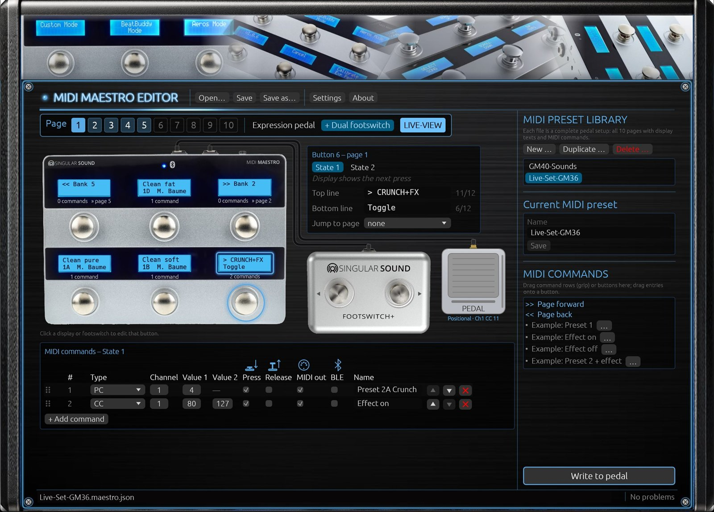
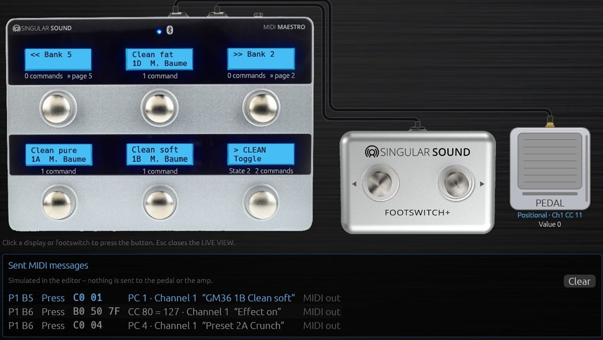
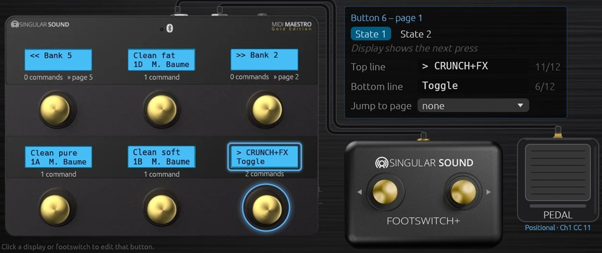

# MIDI Maestro Editor

**A Windows editor for the Singular Sound MIDI Maestro foot controller.**
Program display texts, MIDI commands, two states per button and page jumps comfortably on your PC,
try everything out in a live simulation and write it to the pedal via Bluetooth.

**[⬇ Download the latest version](../../releases/latest)** · Windows 10 / 11 · free · no installation ·
English, Deutsch, Français, Español

---

## Features

- **Edit all 10 pages** with 6 buttons each – top and bottom display line, up to 32 MIDI commands per
  state (Program Change, Control Change, Note On/Off, Pitch Bend), MIDI socket and/or Bluetooth MIDI.
- **Two states per button** (e.g. effect on / effect off) and **page jumps** for browsing banks.
- **LIVE-VIEW** – try the pedal like the real device and see every MIDI message it would send
  (hex bytes, channel, name, output). Nothing is sent while you try things out.
- **Write to the pedal via Bluetooth** – *Write everything* or *Only changes* (usually a few seconds).
- **MIDI preset library** – keep all your setups as files; the editor marks the one that is in the pedal.
- **MIDI COMMANDS** – reusable building blocks: drag them onto a button.
- **Dual footswitch** (page back/forward) and **expression pedal** (positional or relative) with live preview.
- **Checks every setup** before writing (texts too long, values out of range, more than 4 BLE commands …).
- **Silver or black** – the look follows your device. The interface size adapts to your screen (also Full HD).
- **Portable** – a single exe; all data lives in the folder `MIDI-Maestro-Editor-Daten` next to it.
  Ideal for a USB stick.

| | |
|---|---|
|  |  |

## Getting started

1. Download `MIDI-Maestro-Editor-1.0.0-windows.zip` from the [releases page](../../releases/latest) and unzip it.
2. Start `MIDI-Maestro-Editor.exe`.
   > **First start:** Windows may show *“Windows protected your PC”* (SmartScreen) because the editor is
   > not digitally signed. Click **More info → Run anyway**. Alternatively: right-click the exe →
   > **Properties** → tick **Unblock** → OK.
3. To write to the pedal: disconnect the phone app, press the **pairing button** on the MIDI Maestro and click
   **Write to pedal**. Switch the pedal off and on again afterwards to see the new setup.

📖 **Manuals:** [Quick Guide (English)](docs/MIDI-Maestro-Editor_Quick-Guide_EN.pdf) ·
[Kurzanleitung (Deutsch)](docs/MIDI-Maestro-Editor_Kurzanleitung_DE.pdf)
🎬 **Demo film (1:43 min):** [watch on YouTube (English)](https://youtu.be/ta970BqabkQ) ·
[auf YouTube ansehen (Deutsch)](https://youtu.be/-0VEG37f9Cs)

## Good to know

- Requires a Windows PC with Bluetooth (Windows 10 or 11).
- Via Bluetooth MIDI the MIDI Maestro sends only the first 4 commands of a press; all 32 go out through the
  MIDI socket. Expression pedal values are sent through the MIDI socket only.
- The pedal’s setup cannot be read back – keep your setups as files.
- Tested with the MIDI Maestro (firmware as of November 2026), the Singular Sound Footswitch+ and an
  expression pedal.

## Feedback

Found a bug or have an idea? Please open an [issue](../../issues).

☕ **Enjoying the editor?** The MIDI Maestro Editor is free and a private hobby project. If it saves you time,
you can support it with a coffee: [buymeacoffee.com/maba](https://buymeacoffee.com/maba) – thank you!

## Licence

The MIDI Maestro Editor is **freeware** – free to use privately and commercially; see [LICENSE.txt](LICENSE.txt).
It uses open-source components under their own licences, listed in [THIRD-PARTY-NOTICES.txt](THIRD-PARTY-NOTICES.txt).
The source code is currently not published.

The product photos of the MIDI Maestro and the Footswitch+ are used with kind permission of Singular Sound.
Singular Sound, MIDI Maestro and Footswitch+ are trademarks of their respective owners. The MIDI Maestro Editor is
a private project by Matthias Baume and not an official Singular Sound product.

---

## Deutsch

Der **MIDI Maestro Editor** ist ein kostenloser Windows-Editor für den Fußcontroller Singular Sound MIDI Maestro:
Display-Texte, MIDI-Befehle, zwei Zustände pro Taste und Seitensprünge bequem am PC belegen, in der LIVE-VIEW
ausprobieren und per Bluetooth ins Pedal schreiben. Ohne Installation, Oberfläche in Deutsch, Englisch,
Französisch und Spanisch.

**[Download](../../releases/latest)** · [Kurzanleitung (PDF)](docs/MIDI-Maestro-Editor_Kurzanleitung_DE.pdf) ·
[Vorführfilm auf YouTube (1:43 min)](https://youtu.be/-0VEG37f9Cs) ·
☕ [Spendier mir einen Kaffee](https://buymeacoffee.com/maba)

> **Beim ersten Start** zeigt Windows eventuell „Der Computer wurde durch Windows geschützt“. Dann auf
> **Weitere Informationen → Trotzdem ausführen** klicken (oder vorab: Rechtsklick auf die Exe → Eigenschaften →
> „Zulassen“ anhaken).
